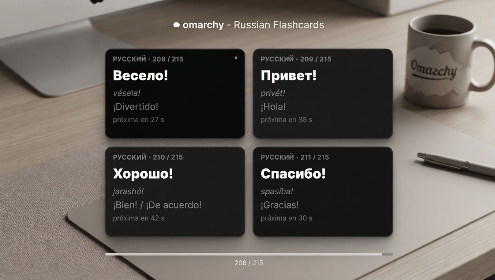

# madmasx.russian-phrases 🇷🇺→🇪🇸

Tarjeta flotante para el escritorio **omarchy** que muestra **frases en ruso** con su
pronunciación (transliteración para hispanohablantes) y la traducción al español,
rotando automáticamente cada 30 segundos.

- 📖 **355 frases** organizadas por tema: saludos, cortesía, presentaciones, comida,
  compras, números, tiempo, viajes, trabajo, emociones…
- 🔊 **Pronunciación fonética** pensada para hablantes de español (sílaba tónica
  marcada).
- 🖱️ **Arrastrable con la mano**: muévela a donde quieras y la posición se guarda.
  Doble-clic → vuelve a su anclaje configurado.
- ❌ **Botón de cierre** (✕) para ocultarla cuando no la necesites; se reabre con
  `omarchy-shell shell summon madmasx.russian-phrases`.
- 🧹 **Fondo libre**: solo la tarjeta captura el ratón; todo el resto de la superficie
  deja pasar los clics al escritorio (cambiar fondo, tema, funciones…).
- 🎨 Colores del **tema omarchy activo** y opacidad ajustable.



---

## Instalación

### Desde git (recomendado, para mantener actualizaciones)

```bash
git clone https://github.com/madmasx/russian-phrases-omarchy.git ~/.config/omarchy/plugins/madmasx.russian-phrases
```

### A mano

Copia la carpeta `madmasx.russian-phrases` dentro de los plugins de omarchy:

```bash
cp -r madmasx.russian-phrases ~/.config/omarchy/plugins/
```

Luego, al detectar el cambio, omarchy recarga el plugin automáticamente
(`Local plugin changed, reloading: madmasx.russian-phrases`).

## Uso

- **Arrastrar**: mantén pulsado sobre la tarjeta y muévela. La posición se persiste.
- **Doble-clic**: re-ancla la tarjeta a la posición configurada (y persiste).
- **Cerrar**: clic en la **✕** de la esquina superior derecha. La tarjeta empieza
  visible en cada sesión; se reabre con el atajo o vía shell.
- **Rotación**: cada frase se muestra unos segundos y pasa a la siguiente.

### Atajos (bindings de Hyprland, edita `~/.config/hypr/bindings.lua`)

```lua
o.bind("SUPER + H", "Frases de ruso (mostrar)", "omarchy-shell shell summon madmasx.russian-phrases '{}'")
o.bind("SUPER + SHIFT + H", "Frases de ruso (ocultar)", "omarchy-shell shell hide madmasx.russian-phrases")
```

> ⚠️ El método IPC para ocultar es **`hide`** (no existe `shell close`; ese devuelve
> `Function not found.` y la tarjeta nunca se cierra).

## Configuración

Crea/edita `~/.config/omarchy/russian-phrases.json` (recarga en caliente):

```json
{
  "intervalSec": 30,
  "position": "bottom-right",
  "margin": 24,
  "cardWidth": 380,
  "cardOpacity": 0.78,
  "showHeader": true,
  "fontScale": 1.0
}
```

| Clave         | Tipo    | Por defecto    | Descripción                          |
|---------------|---------|----------------|--------------------------------------|
| `intervalSec` | number  | `30`           | Segundos entre frases (5–3600).      |
| `position`    | string  | `bottom-right` | Esquina: `bottom-right` / `bottom-left` / `top-right` / `top-left`. |
| `margin`      | number  | `24`           | Margen a la esquina.                 |
| `cardWidth`   | number  | `380`          | Ancho de la tarjeta (220–900).       |
| `cardOpacity` | number  | `0.78`         | Opacidad del fondo (0.2–1).          |
| `showHeader`  | bool    | `true`         | Mostrar la cabecera "РУССКИЙ · n/N". |
| `fontScale`   | number  | `1.0`          | Escala de fuente (0.5–2).            |

La posición libre (`freeX` / `freeY`, tras arrastrar) también se guarda en este JSON.

## Añadir frases

Cada frase vive en `phrases.js` como un objeto con tres campos:

```js
{ ru: "До свидания", pron: "da svidánia", es: "Hasta la vista" }
```

- `ru` — texto en cirílico.
- `pron` — pronunciación aproximada para español (sílaba tónica en negrita/acento).
- `es` — traducción al español.

Al guardar, el plugin recarga las frases automáticamente.

## Estructura

```
madmasx.russian-phrases/
├── LICENSE                # MIT
├── manifest.json          # Metadatos del plugin (id, licencia, entryPoint)
├── phrases.js             # Las 355 frases (ru / pron / es)
├── RussianPhrases.qml     # Tarjeta + rotación + arrastre + cierre (Quickshell)
├── assets/screenshot.jpg  # Captura para el README
└── README.md              # Esto
```

## Licencia

MIT — © 2026 [Madmasx](https://github.com/madmasx)

---

## `$ ls ~/contacto`

[](https://x.com/madmasx)
[](https://github.com/madmasx)
[](https://buymeacoffee.com/madmasx)